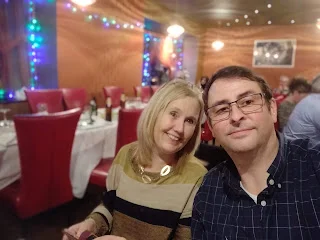
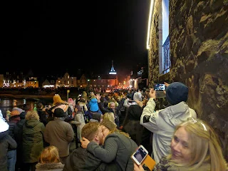

A test might to see how things went after ,y surgery for a broken hip. Nice site, for access to town and quiet surroundings despite being at edge of town.

Lynn was running her pop up  shop which was the main as reason to go and into see Gillian the next day on the way home.

Didn’t actually take any photos so the ones attached are from a New Year visit to the annual fireball event from at least 10 years before

Queen Elizabeth Caravan Site, Stonehaven

<https://maps.app.goo.gl/yPuSGyf18KvAprFF7?g_st=com.google.maps.preview.copy>
