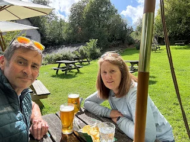
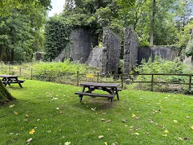
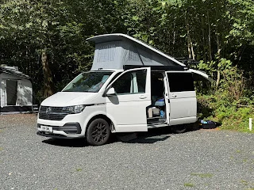
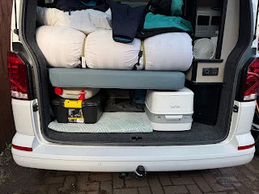

Kendal Caravan and Camping Club Site

20th-21st August 2024

Just 1 night on our way South for Carfest that Denise organised for my 70th.

Site is very wooded with about 140 pitches spread across it. Does not feel it as they are in small openings in the wood with maybe 4-10 vans each so feels small.

Laid out on a hill side with the river from Kendal at the bottom and an old (thankfully abandoned) gunpowder mill. Pitches up the hill have more chance of evening sun.

Walked about 20 mins to a small farm shop with good cakes and viewing of the cows being milked from the cafe! Then sigh my back and under main road to a pub with a nice beer garden and what looked like good.

<https://maps.app.goo.gl/vGgzoUDrE2JG5ZWt5?g_st=com.google.maps.preview.copy>

