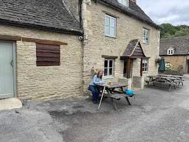
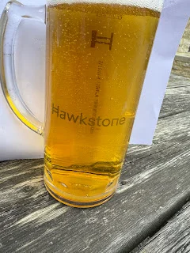
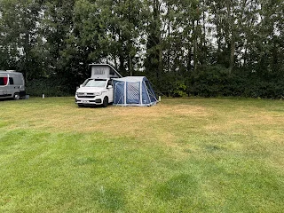
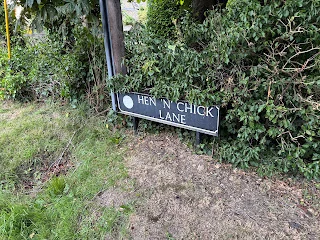
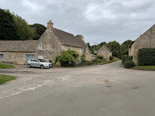
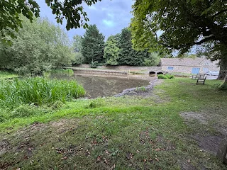

Burford CAMC Site

Arrived about 2pm and set up the awning for the first time this year. No big fights and seemed to remember how to do it. The site is opposite a wild life park and there were odd animal sounds of according to one review Lions calling each other??

No surprise we walked over to The Shilton Rose and Crown for drinks and food. Just been restored over the last 2 years and was lovely. Cotswold stone, low ceiling and great food and beer. Tried Hawkstone lager from Clarkstons Farm fame, actually very good, malty not sweet and not fizzy, a good pint.

The villages round here are just what you imagine, lovely cottage’s in local stone, duck ponds and little lanes.

<https://maps.app.goo.gl/XjByP75pivYUmFTQ7?g_st=com.google.maps.preview.copy>

