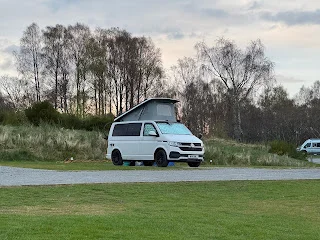
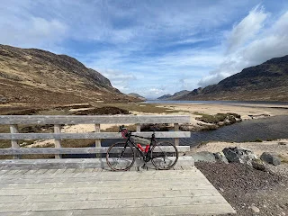

Oakwood Caravan and Camping Park

Granish, Park, Aviemore PH22 1QD

Two days away cycling some trails nea Aviemore. Just myself, Denise at home on Granny watch.

Managed an 80k cycle with 800m climbing almost entirely traffic free and mostly gravel.

Aviemore – Boat of Garten along the spay – over the Slogan pass (apt) to Loch Morlich then down to Kintail.

<https://maps.app.goo.gl/hA7Nw6kNEoHXbxyEA?g_st=com.google.maps.preview.copy>

