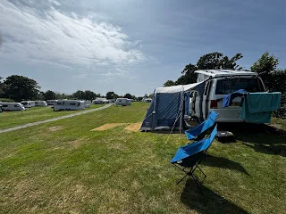

Llanystumdwy Camping and Caravanning Club Site

2 nights very near Pwllheli Wales National sailing centre, well the town needs something as a draw.

We are about 2 miles away from it on a lovely  little site with very friendly wardens, apparently, the middle showers are called the beast cause they’re so strong.

strangely parked side on for a change as it’s quite hilly.

Nearest pub about 10 minutes walk and main village about 10 minutes cycle

<https://maps.app.goo.gl/ReVTA5anY6z8DsYN9?g_st=ipc>

