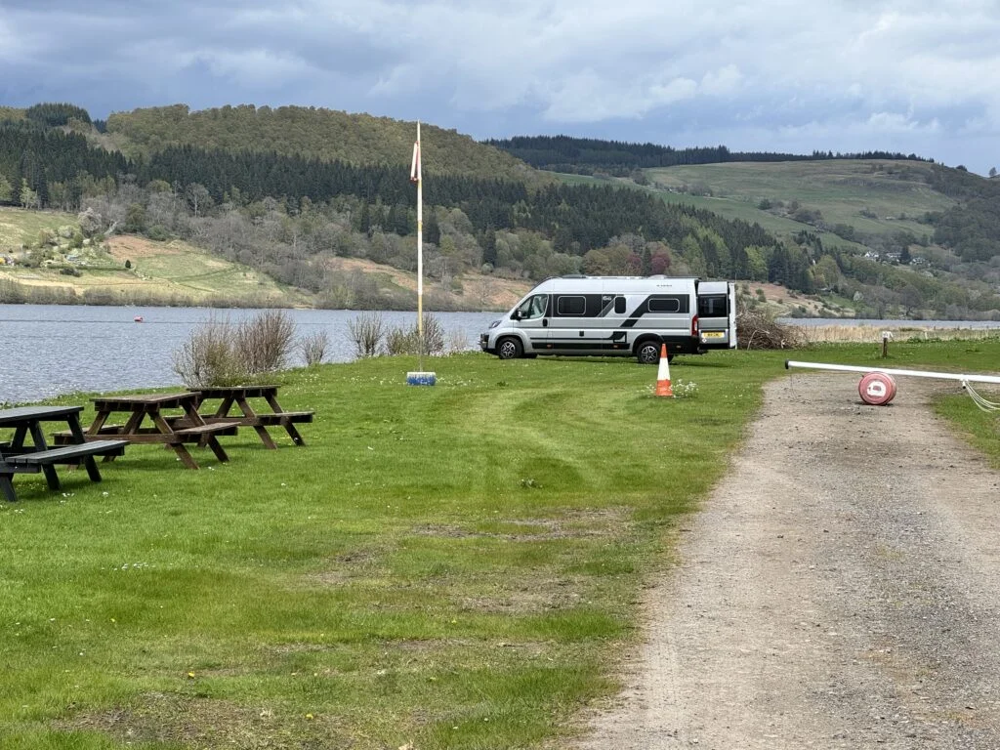
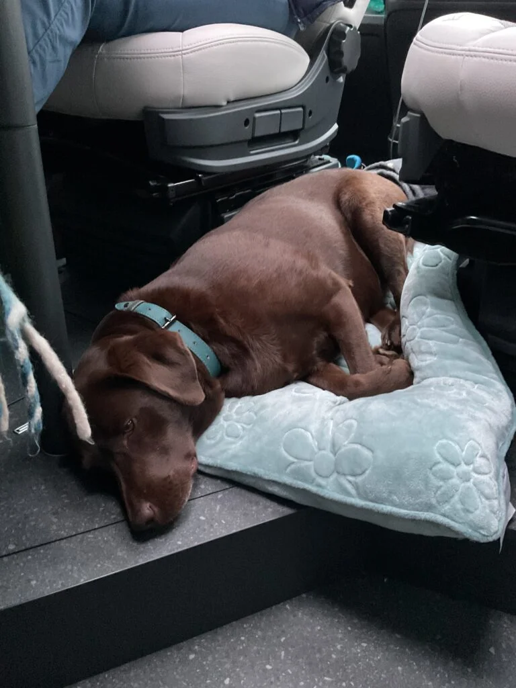
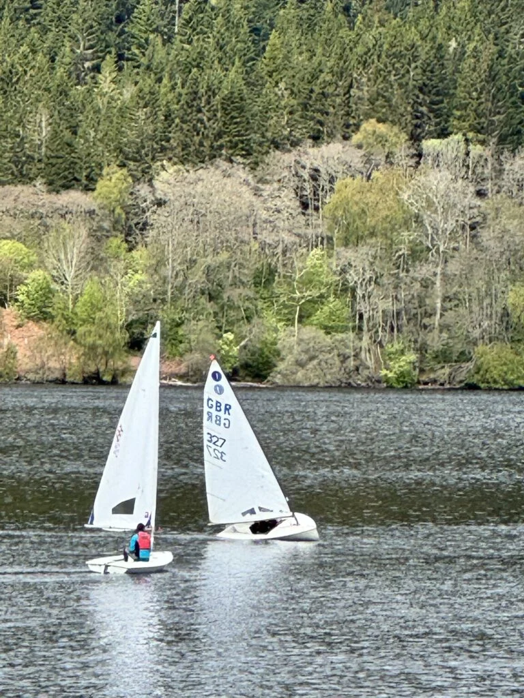
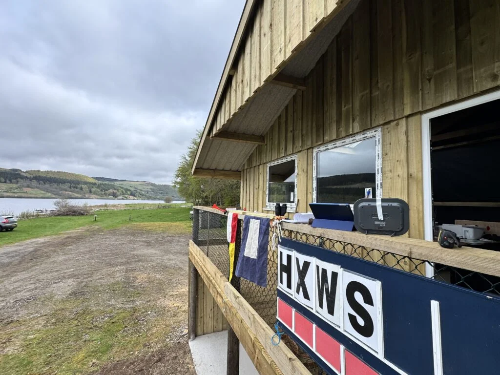
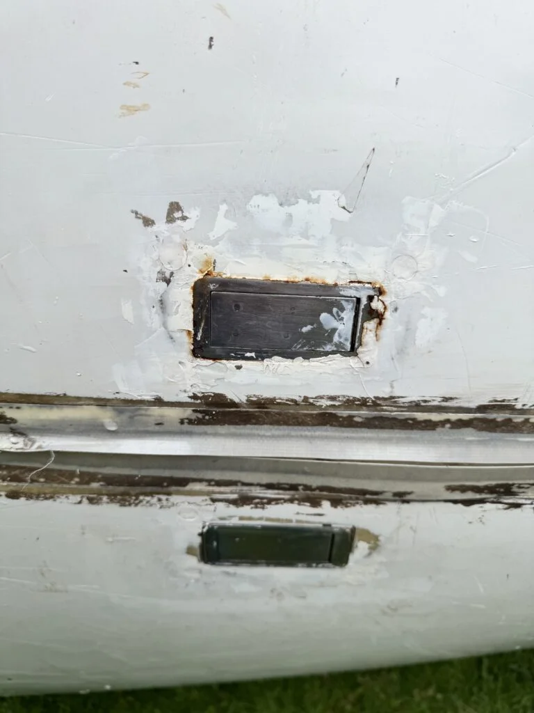
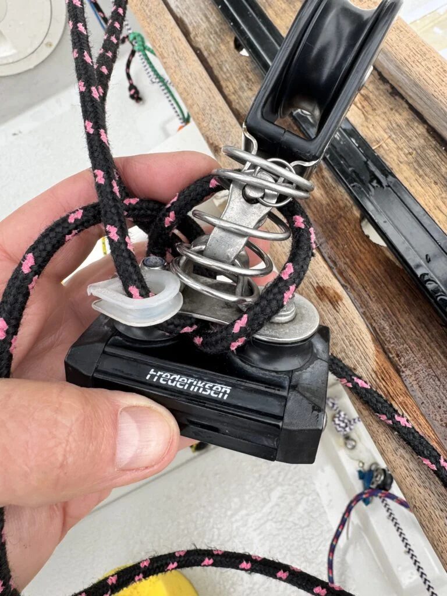
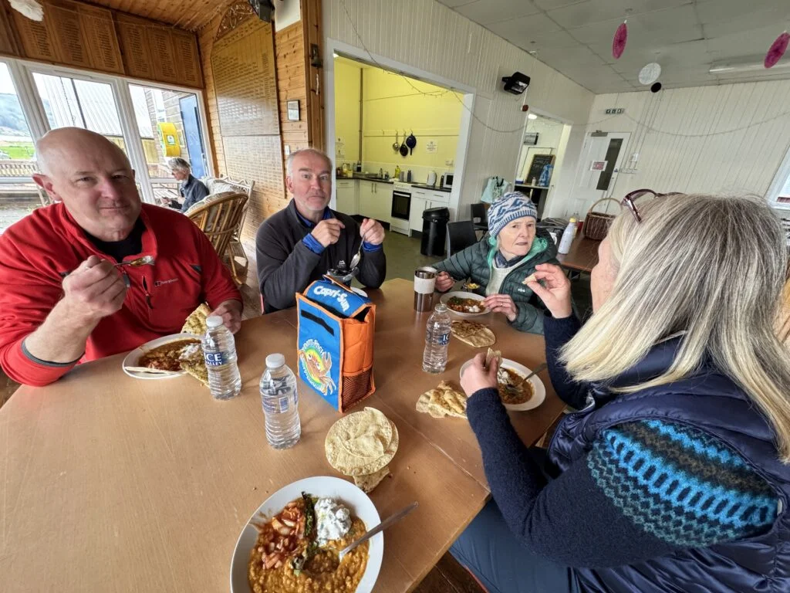

Took the van up to the sailing club at Loch Tummel for the opening event. As the chalet we have there is out of commission (dam water pipes and winter)

Quite 2 nights with a bust from Andy and Jenny on Saturday, Sunday I was race officer and Denise sailed. The first trip in the Adria with the dog, hmm going to get her a soft crate so perhaps she will settle at night.

Unfortunately her boat has started to fall apart, not convinced it’s worth repairing so off to look at another one Wednesday.

After the sailing the club Ben hosted us to a curry meal of homemade dhal and sides.

