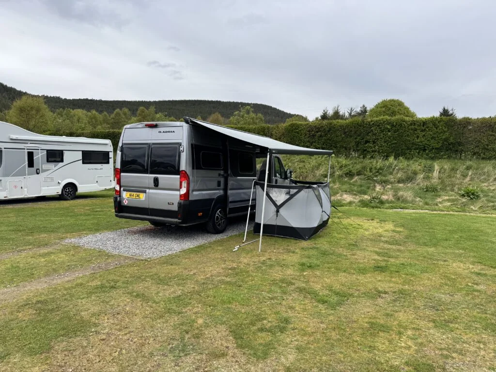
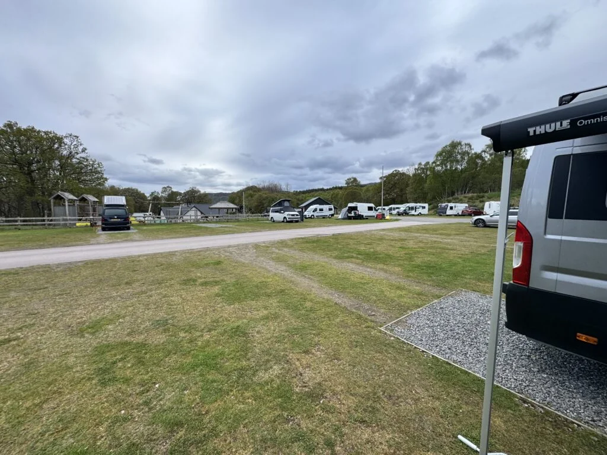
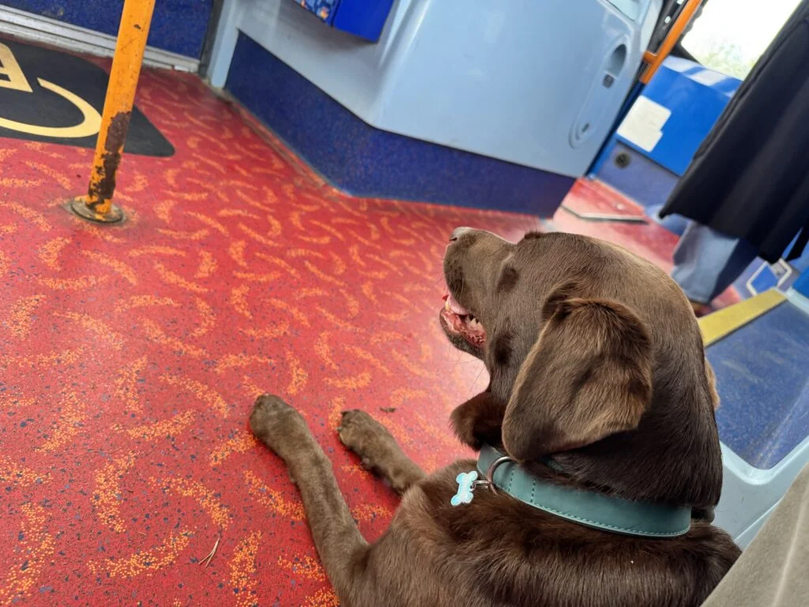

Start of a week away around the Deeside coast, we think. Only thing booked is 2 nights here in Oakwood on the north side of Aviemore.

Nice independent site, friendly staff and very clean. I was here about a year ago on my own for 2 days cycling.

Tried out the new wind break for the first time, effective and with the roll out awning was definitely a bit warmer.

Walked into town with Cleo, she was very well behaved and a few beers in the way back but at £7.30 I think it will be drinks at the van from now on.

Woke up on Tuesday to heavy rain so started with a lazy few hours then risked a walk into town with coffee at the Route 7 Cafe and then all the way to the station.

On the way back we decided to take Cleo on the bus, her first ever experience, actually went OK. The driver kindly dropped us right at the campsite entrance (not an official stop).

Location: <https://maps.app.goo.gl/JZrdVFLiu8oCucnz5?g_st=ic>
