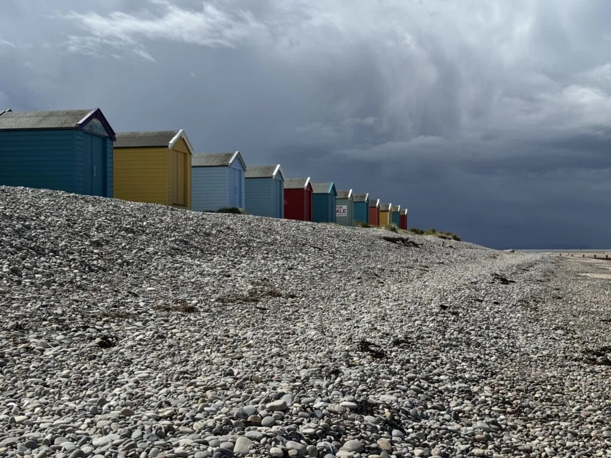
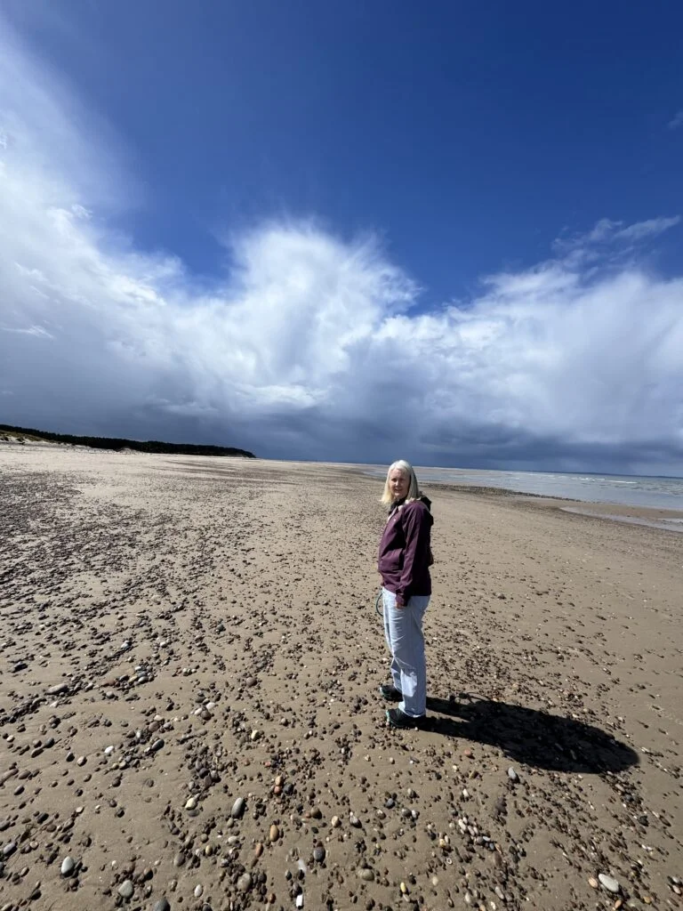
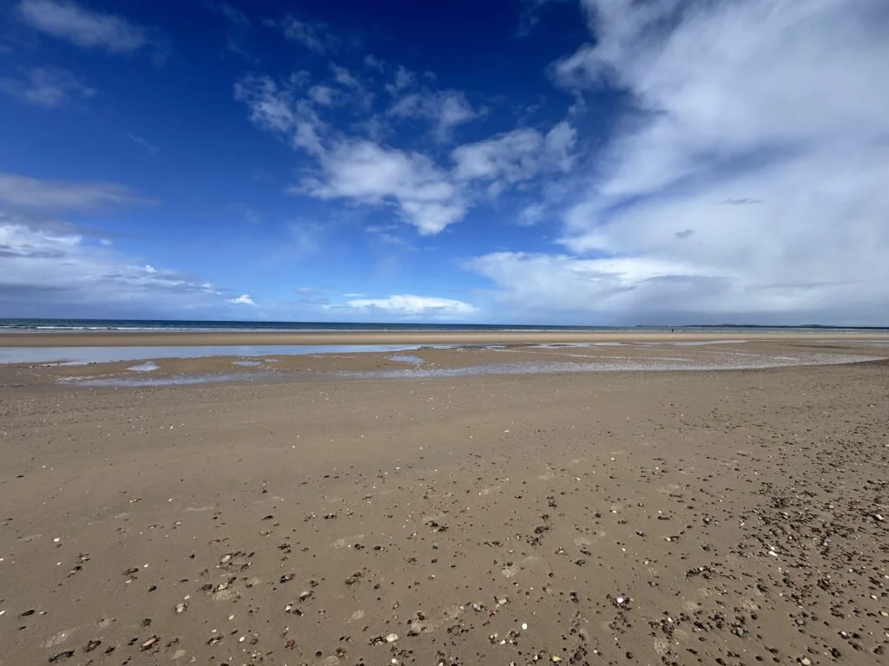
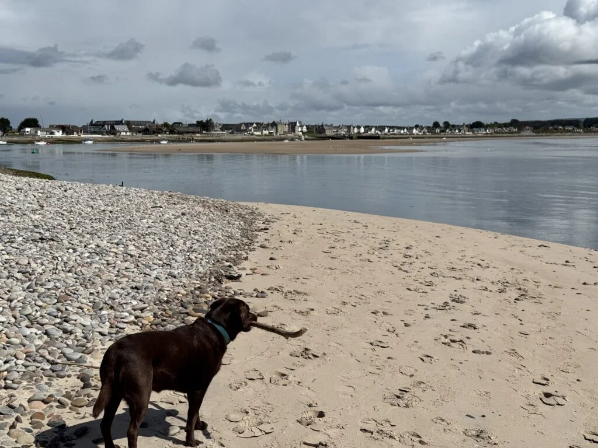
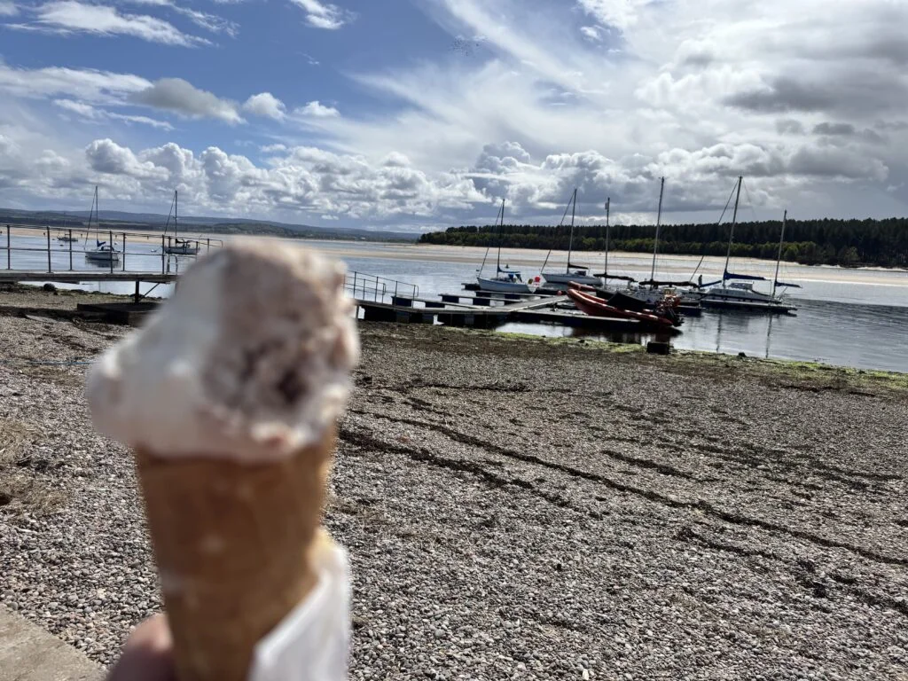

One night at Findhorn beach motorhome stop on the beach. Simple hard standing pitches with no hookup, but black, grey waste and fresh water.

Less than 2 minutes to a huge expensive beach that Cleo loved! Felt like an English beach with the shingle washed up and colourful beach huts (some for sale). Walked along and round into the Findhorn bay inlet and up the marina (well moorings and a pontoon).

Had a great meal in the evening at the Kimberly Inn, well priced, quick service and tasted great.

Tried out the shower for the first time in the morning, worked well, lots of pressure and it was hot.

<https://www.findhornvillageconservation.org.uk/motorhome-stopover>

We were going to go along the coast for the next night but we was so windy we headed inland towards Banchory.

<https://maps.app.goo.gl/2mwmqVExHWNsABYC7?g_st=ic>

