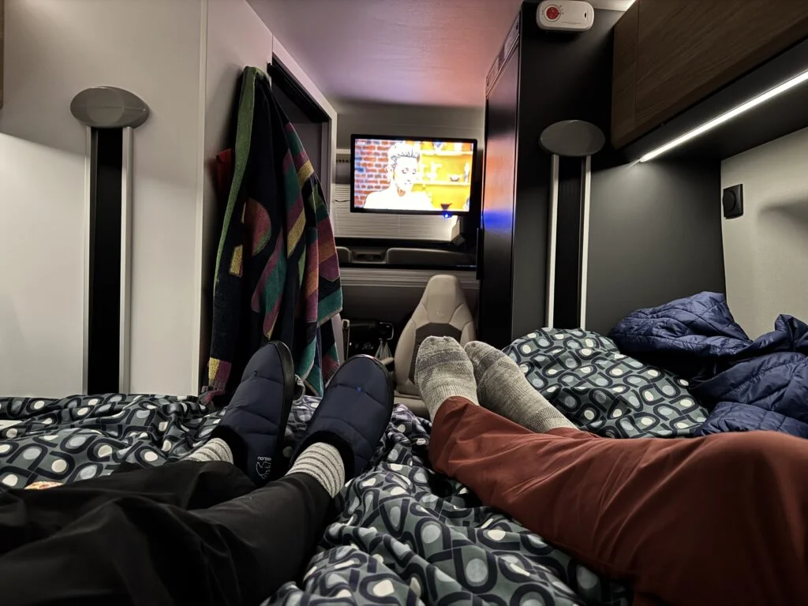
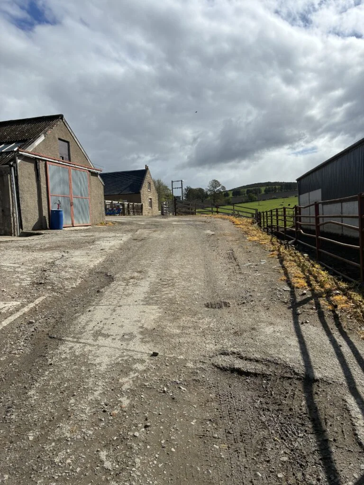
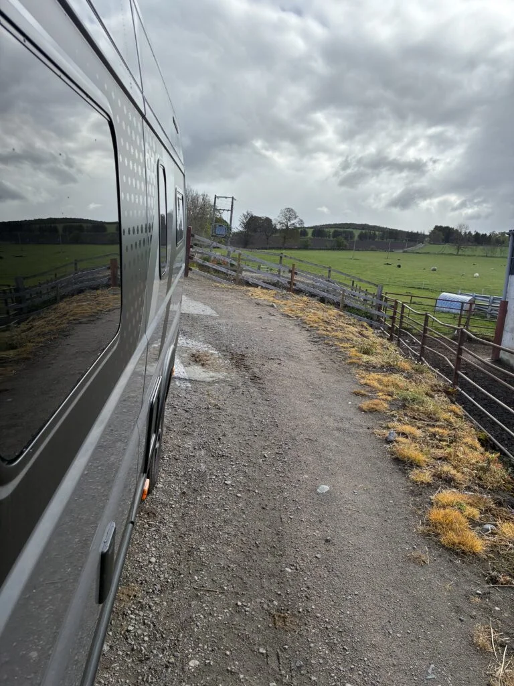
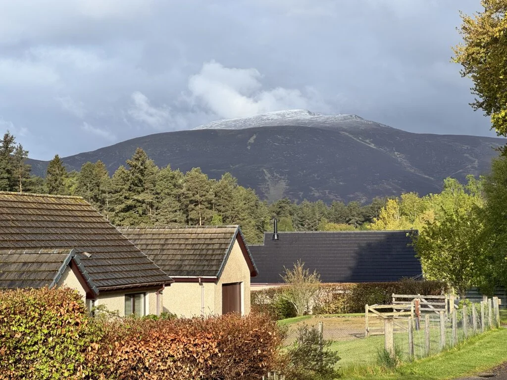
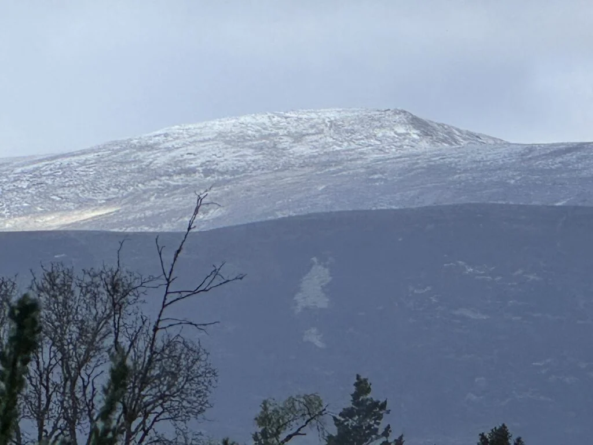
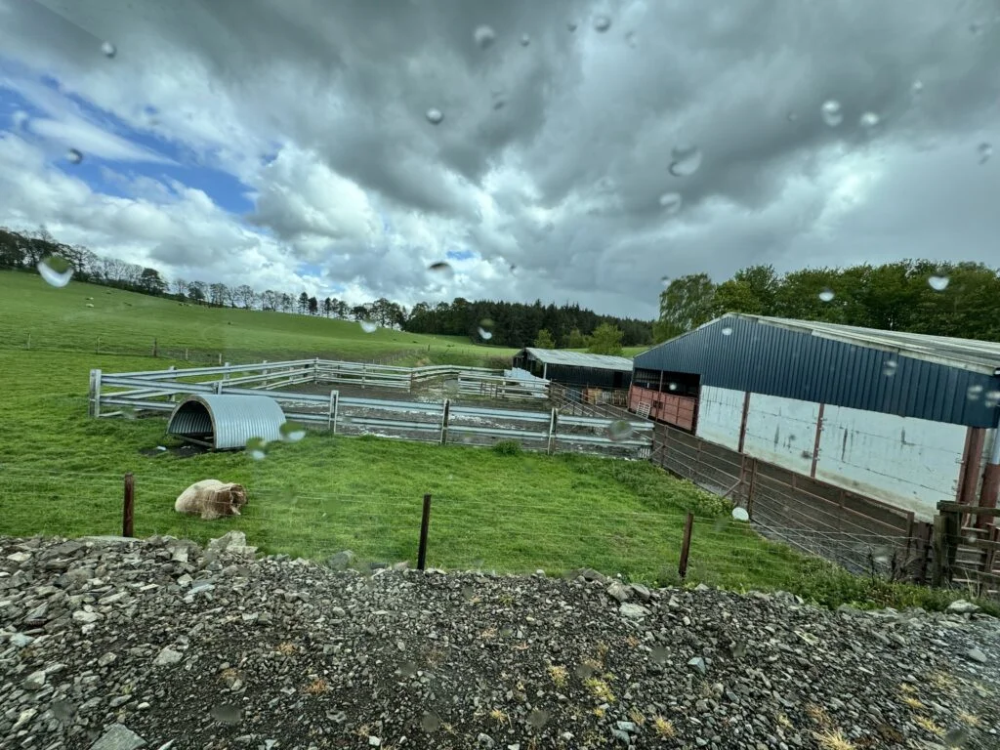

Coldstone near Banchory

14th-15th May 2026

After the windy battering at Findhorn we moved for the last night in the van for this trip (stayed with Lynn and Dave in Westhill on the Friday) and ended up on a farm Aire.

Space for 3 (would be a bit tight) but offered EHU (we did not bother), water along with grey and black waste. Lesson learnt, must remember to let the hose empty as a few minutes after parking up and filling with water there was a puddle on the floor. After a panic we worked out it was only the hose emptying out!

A much quieter night out of the wind but it did rain but cleared up mostly by the morning. We did work out that when it rains you watch TV in bed.

Walked the dog over tho the village (1 pub and 1 shop) through the woods, took about 30 minutes and apart from the mud was a nice walk.

On leaving in the morning we paid our dues of £10 (bargain) and emptied our grey waste over a grill as directed which turned out to be the slurry pit between two cow sheds.

<https://maps.app.goo.gl/SwCarfiAZoaq4pHj9?g_st=ic>
