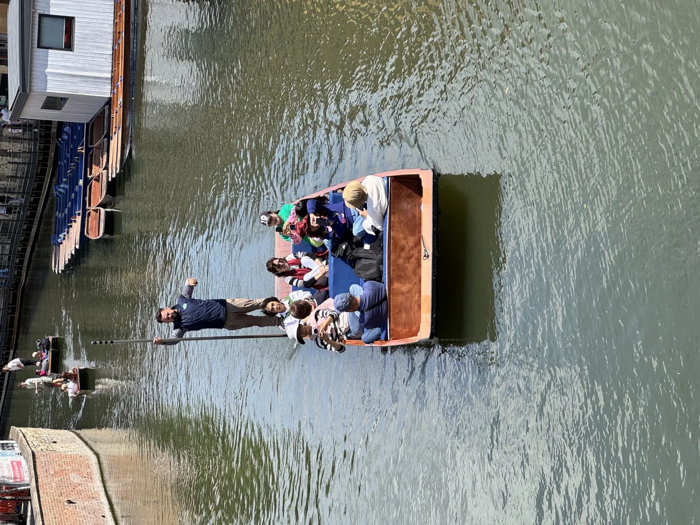
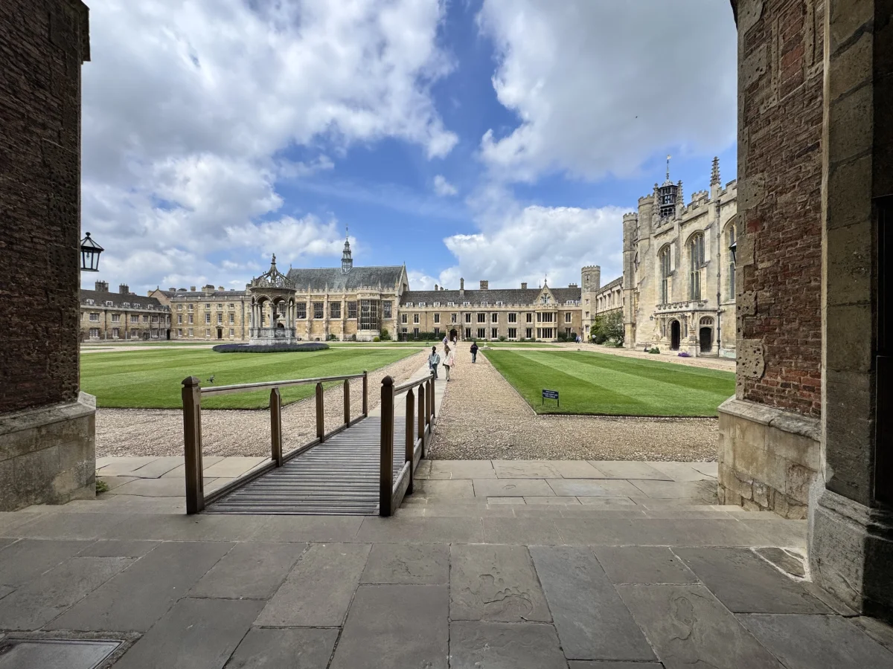
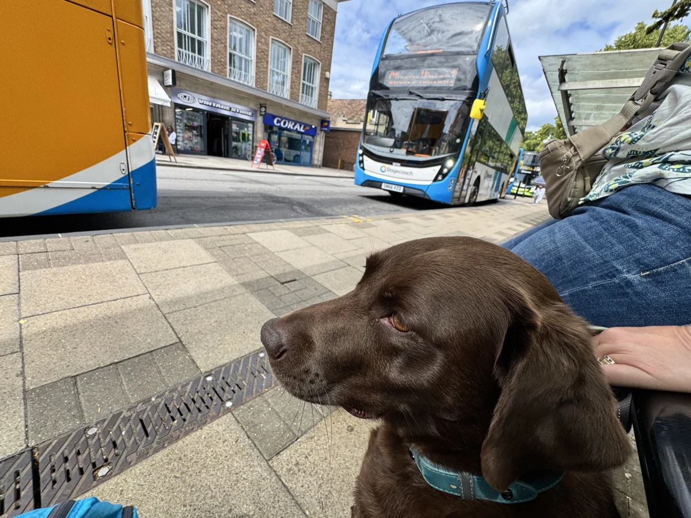
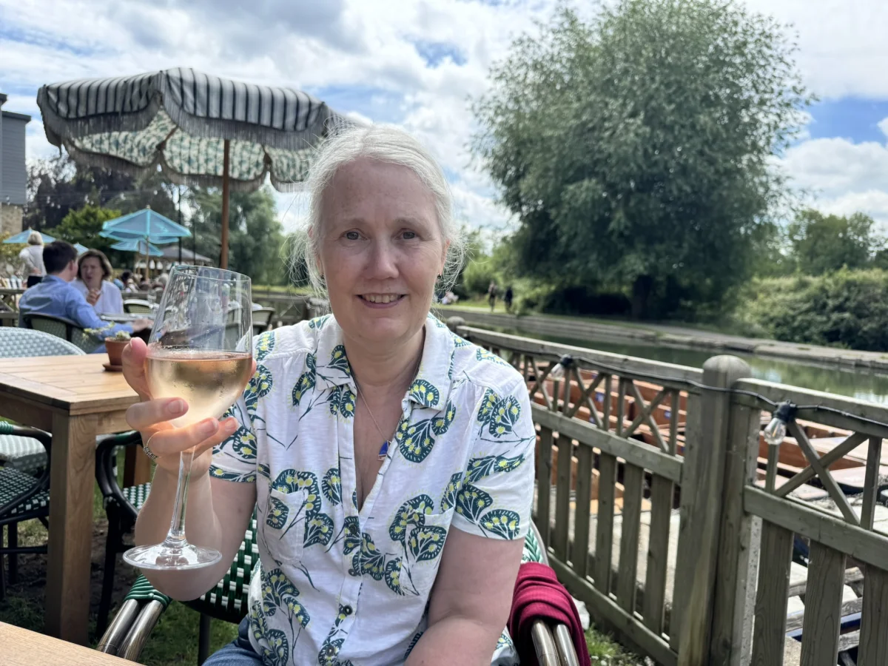
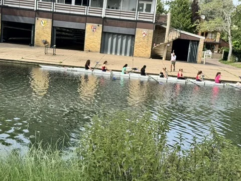
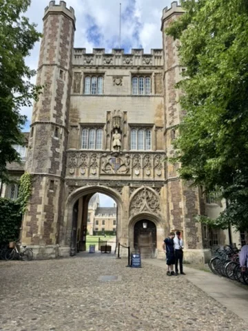
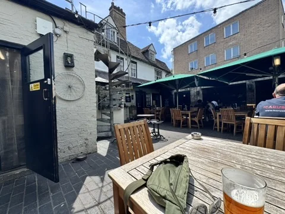
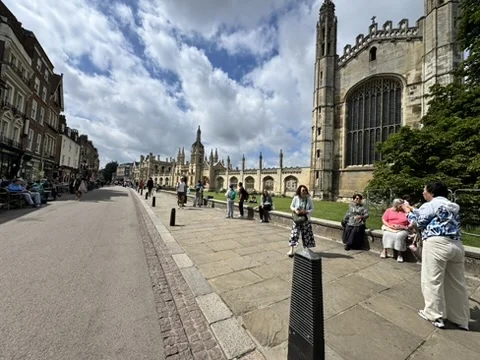
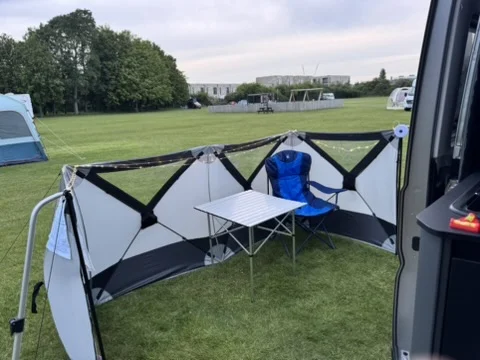

Next stop this tour was Cambridge at a CCC larger site. Large grass field with not a lot of screening around. Later we spotted that there was a smaller part of the site behind some trees.

Once we were setup i cycled into the city to get the lay of the land, took about 20 mins along the tram/bus way then mostly quiet roads and parks.

Denise found a great dog walk the next morning across the road and after breakfast we managed to get Cleo onto the bus and into town. Much less drama than our previous experiences with her in busy city's.

The city was everything i had expected, from the old colleges laid our in their grounds, to quirky shops.

We had a very nice light lunch down by the river watching the punting and then a further wander including a pint in the oldest pub in Cambridge.

