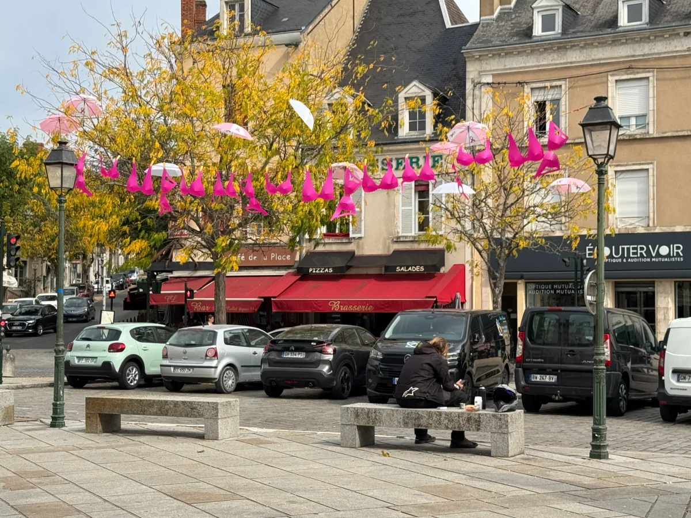
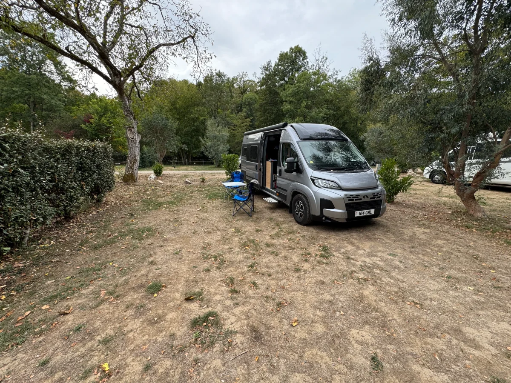
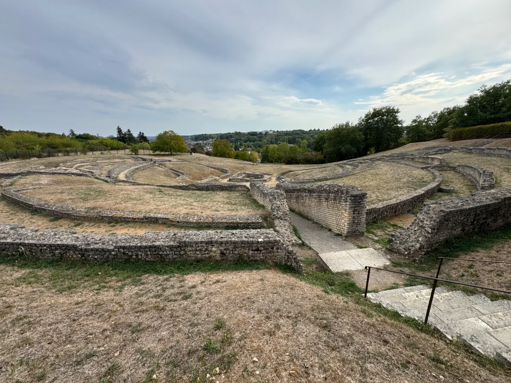

One night at Camping Les Chambons in Argenton-sur-Creuse to breakup the long drive south.

Small site by the river in a town with a Roman amphitheatre up on the hill above. We had a walk around town on arrival that was a mix of modern businesses with old houses and mills along the river side.

Our first encounter with the 'no toilet paper' that is seems is common in many campsites across France, I still do not get why there are no toilet seats anywhere!

A couple from Northumberland next to us could not get their mains power to work, we tried our cable and onto other posts but to no avail. Luckily they had battery for lights and the main power draw which is the Fridge would run from gas or electric.

