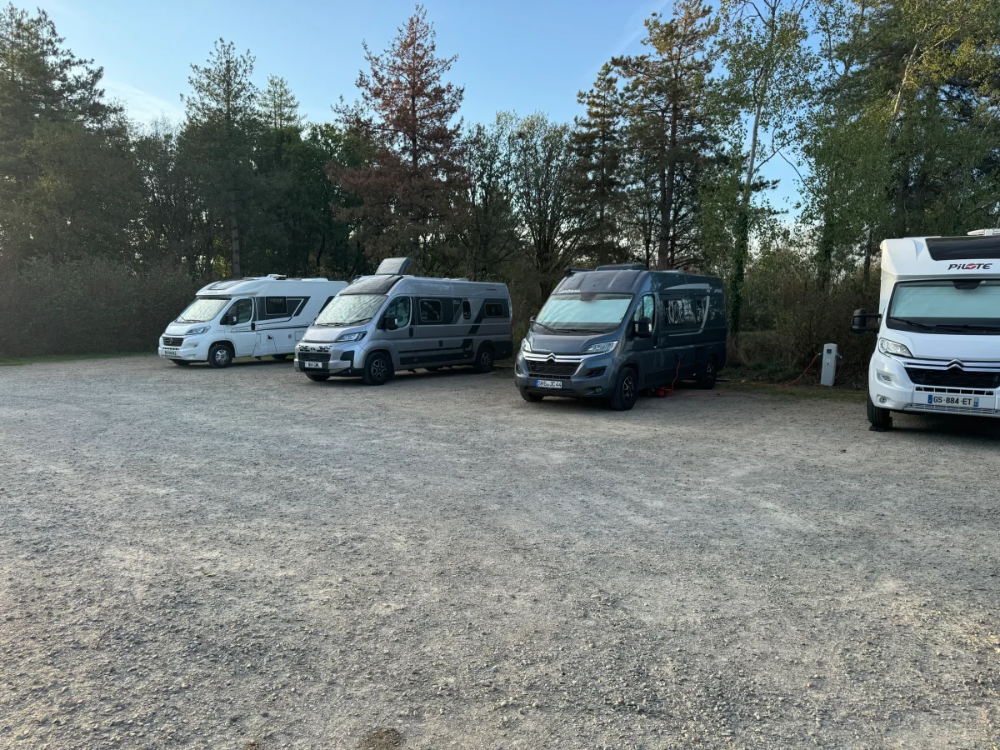
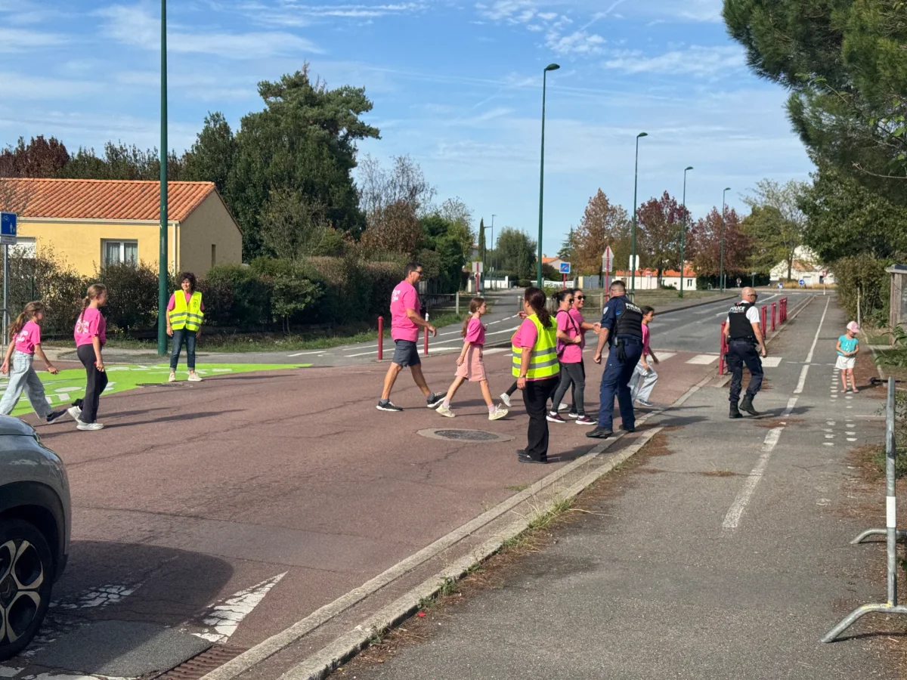
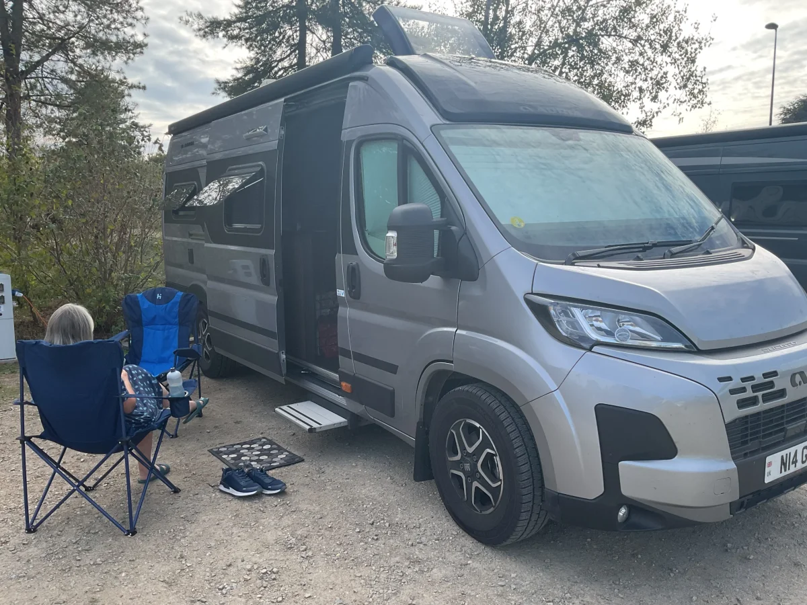
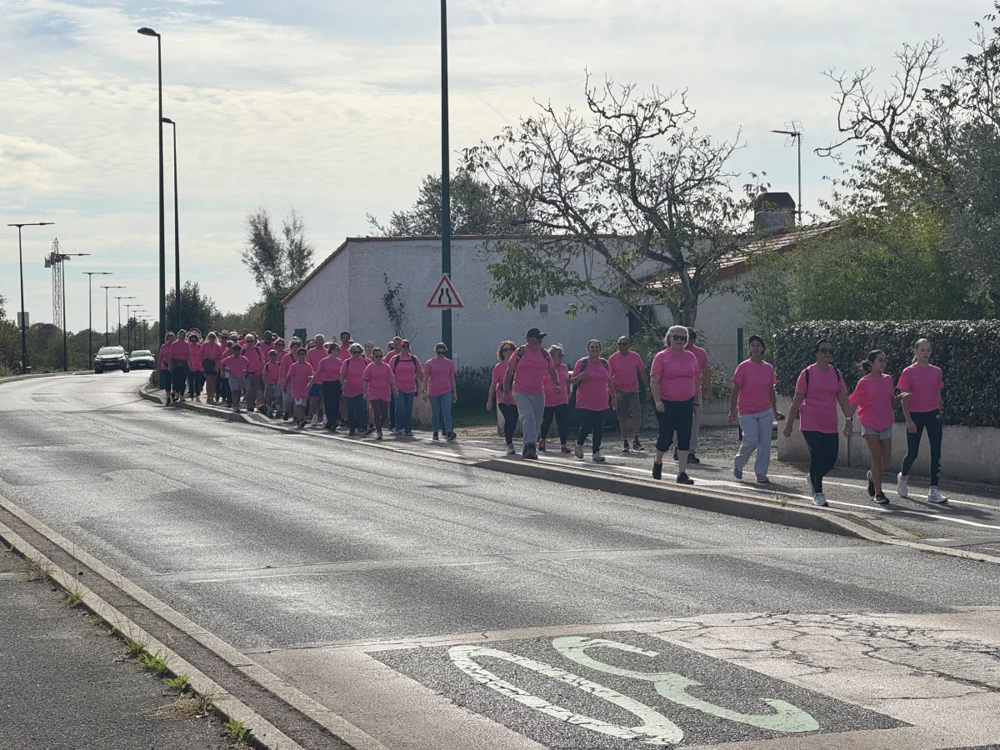
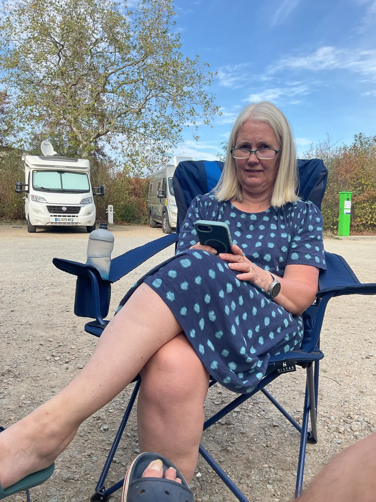

Stop off on the way back North in a town to visit a Motorhome accessories shop that had been recommended to us ny the Milfords.

Got a new much larger awning carpet that is light weight and folds down small, this will be a big improvement.

The Aire had space for 8 vans and ended up being ful for the night. Happend that a sponsored walk/run for October Rose (French Breast Cancer awareness month) has passing right by the corner and into the park behind us.

Had a walk in the evening round the park of now abandoned chateau and small lake. Quiet night and our first Aire in France, part of the CampingCar Aire network.

