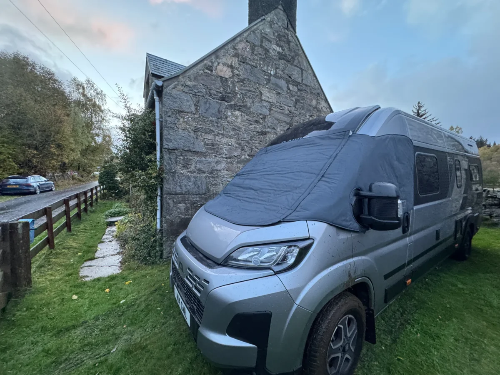
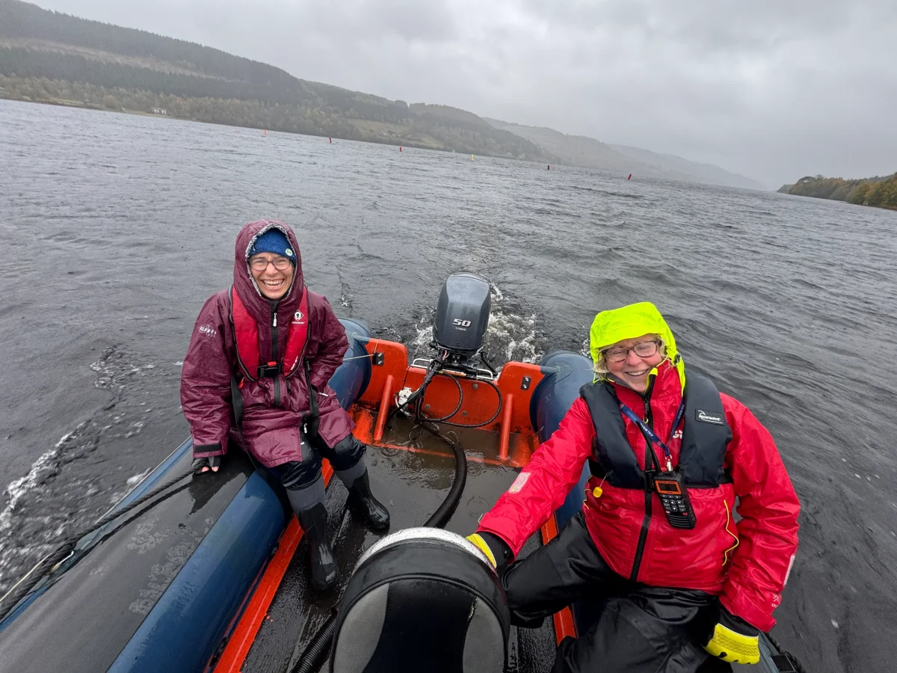
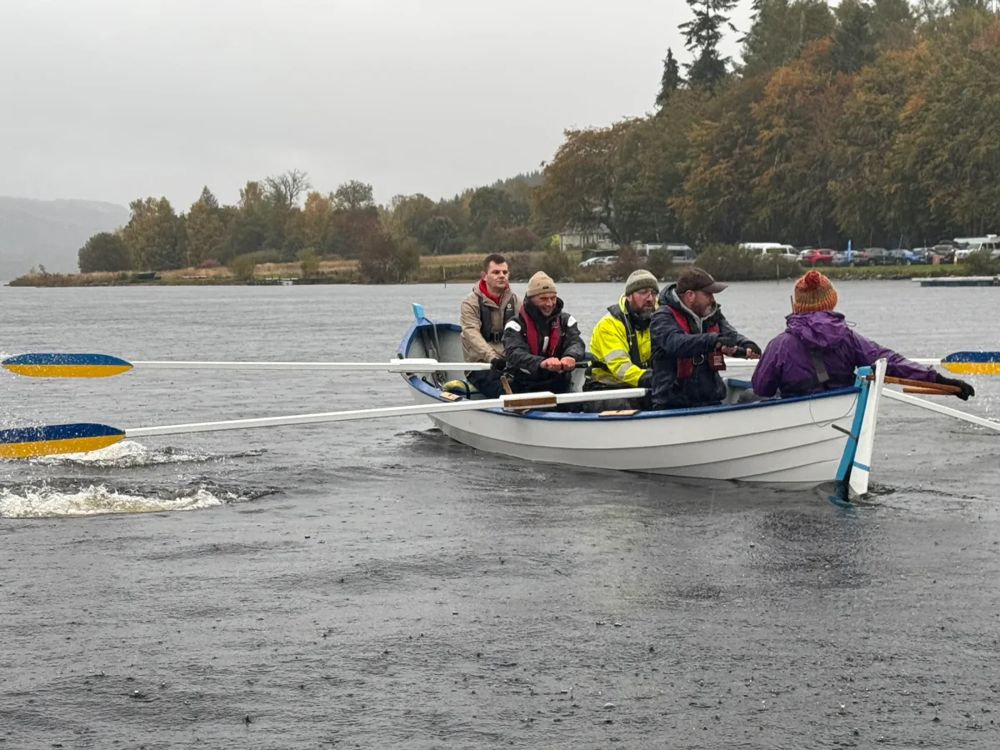
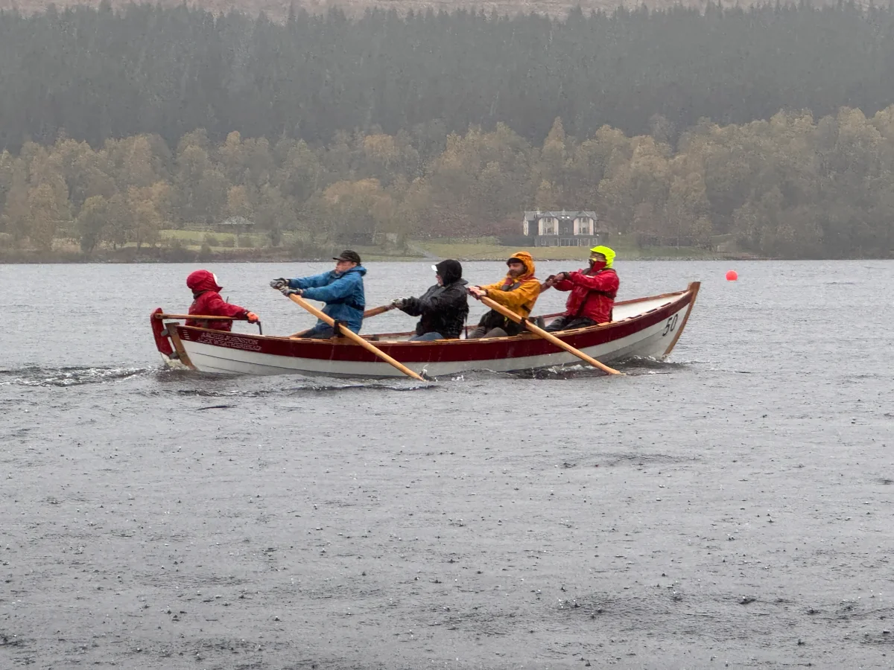

Went up to the sailing club on the Friday with the van to clear the chalet for the winter and help setup of the Scottish Coastal Rowing Inland’s on the Saturday.

Denise came up late Friday evening having towed the boat trailer up empty.

The event was the normal 66% talking and a bit or rowing, I spent a few hours in the rain running the umpires up and down to course and then managed to pack Denise’s boat up which she trailed away before it got dark.

I stayed up another night so as to help with the drain down of the club along with Ben and some final cleaning up for the year. The Saturday night it got very windy anf glad I had moved the van up the road to shelter next to the Barrons cottage.

Next morning the rod was covered in branches and impassible due to tree down, luckily Ben had a bushman saw at the cottage and we soon cleared the road.

